<div align="center">

# Plateforme e-commerce et logistique synchronisée avec Sage X3

### Projet de Fin d'Etudes 2026

Plateforme full-stack réunissant e-commerce B2C/B2B, gestion commerciale, livraison Cash on Delivery, transit inter-dépôts, tableaux de bord et assistance décisionnelle.

**Réalisé par Melek Lahmar et Tawfik Siala**<br>
**Dépôt portfolio maintenu par Melek Lahmar**

[](#contexte)
[](frontend-react/)
[](backend-aspnet-api/)
[](mobile-flutter/)
[](#stack-technique)
[](#sage-x3)
[](#n8n)

</div>

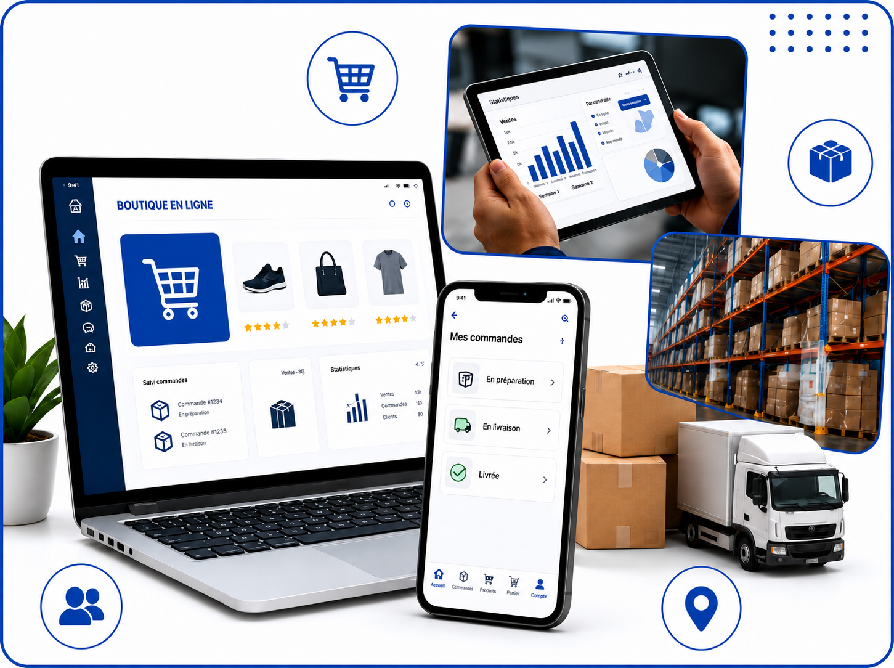

> Ce dépôt présente une solution académique fonctionnelle construite autour d'un besoin métier réel : relier les usages web et mobile aux données commerciales de Sage X3, tout en centralisant la commande, la confirmation, la livraison, les réclamations et le pilotage administratif.

---

## Sommaire

- [Résumé exécutif](#resume)
- [Contexte académique et professionnel](#contexte)
- [Problématique et objectifs](#problematique)
- [Acteurs et périmètre métier](#acteurs)
- [Architecture globale](#architecture)
- [Flux métier principaux](#flux)
- [Fonctionnalités par module](#fonctionnalites)
- [Orchestration n8n et chatbot administrateur](#n8n)
- [Synchronisation Sage X3](#sage-x3)
- [Organisation Scrum en cinq sprints](#sprints)
- [Conception UML et modèle de données](#uml)
- [Captures de réalisation](#captures)
- [Stack technique](#stack-technique)
- [Structure du dépôt](#structure)
- [Installation locale](#installation)
- [Configuration](#configuration)
- [Sécurité, qualité et validation](#qualite)
- [Limites et perspectives](#perspectives)
- [Auteurs et encadrement](#auteurs)

<a id="resume"></a>
## Résumé exécutif

La solution couvre l'ensemble d'un parcours commercial et logistique :

1. Le client consulte le catalogue, prépare son panier et passe une commande.
2. La plateforme crée et suit les documents commerciaux associés.
3. Le confirmateur contrôle la commande et prépare sa transformation en bon de livraison.
4. Le livreur prend en charge la mission, met à jour les statuts et enregistre l'encaissement COD.
5. Le superviseur suit l'activité terrain, les transferts entre dépôts et les anomalies.
6. L'administrateur pilote la plateforme à travers les dashboards, exports, alertes et conversations du chatbot.
7. Sage X3 reste le référentiel des articles, catalogues, dépôts, stocks et documents commerciaux.

Le projet ne se limite donc pas à une boutique en ligne. Il met en relation plusieurs profils, plusieurs canaux et plusieurs systèmes autour d'une Web API centrale.

| Dimension | Couverture |
|---|---|
| Commerce | Catalogue, panier, favoris, commande invitée, B2C, B2B, devis et remises |
| Gestion commerciale | Clients, produits, stocks, bons de commande, bons de livraison et publication ERP |
| Paiement | Paiement à la livraison, paiement en ligne Konnect et suivi des transactions |
| Logistique | Affectation, GPS, statuts, caisse COD, réclamations et transit inter-dépôts |
| Pilotage | KPI, tendances, alertes, exports Excel/PDF, insights et chatbot administrateur |
| Intégration | Sage X3, Cloudinary, Brevo, Konnect, OAuth, SignalR, n8n et Groq |

<a id="contexte"></a>
## Contexte académique et professionnel

Ce projet a été réalisé pour l'obtention de la **Licence en Technologies de l'Information, option Développement des Systèmes d'Information**, à l'**Institut Supérieur des Etudes Technologiques de Sfax**.

Le stage s'est déroulé chez **InfoSoft**, société spécialisée dans les solutions informatiques de gestion et l'écosystème Sage. Son activité couvre notamment la gestion commerciale, la comptabilité, la paie, la production, le conseil, la formation, la maintenance et l'assistance informatique.

Le sujet retenu est :

> Conception et développement d'une plateforme e-commerce et logistique synchronisée avec Sage X3.

Le contexte professionnel a permis de traiter un besoin transversal associant gestion commerciale, commerce électronique, mobilité terrain et intégration ERP.

<a id="problematique"></a>
## Problématique et objectifs

### Problématique

Une utilisation séparée de l'ERP, d'un site e-commerce et d'un outil logistique ne garantit pas une continuité complète entre la vente, le stock, la commande, la livraison et le suivi opérationnel. Les principales difficultés identifiées sont :

- la dispersion des données commerciales et logistiques ;
- la multiplication des étapes et des acteurs dans le traitement d'une commande ;
- le manque de visibilité sur les livraisons, le transit et les incidents terrain ;
- la difficulté de suivre le paiement à la livraison et les réclamations ;
- le risque d'incohérence entre les interfaces numériques et le référentiel Sage X3 ;
- le besoin d'indicateurs synthétiques pour soutenir la prise de décision.

### Objectif général

Concevoir une plateforme intégrée capable de relier le parcours client, la gestion commerciale, la livraison et la synchronisation Sage X3 dans un environnement unique, sécurisé et adapté aux responsabilités de chaque acteur.

### Objectifs opérationnels

- centraliser le catalogue, les clients, les commandes et les livraisons ;
- proposer des parcours distincts pour les clients B2C et B2B ;
- sécuriser l'accès avec JWT, Identity et une autorisation par rôles ;
- synchroniser les données maîtresses issues de Sage X3 ;
- publier des documents commerciaux vers Sage X3 ;
- fournir une application mobile adaptée aux opérations terrain ;
- exploiter SignalR pour le temps réel ;
- produire des tableaux de bord, alertes et exports ;
- permettre l'interrogation des données métier en langage naturel ;
- rendre l'architecture maintenable, testable et évolutive.

<a id="acteurs"></a>
## Acteurs et périmètre métier

| Acteur | Responsabilités principales |
|---|---|
| Visiteur | Consulter le catalogue, rechercher des produits et créer un compte |
| Client B2C | Gérer profil, adresses, panier, favoris, commandes, paiement, suivi et réclamations |
| Client B2B | Demander un devis, bénéficier de remises commerciales et suivre ses commandes professionnelles |
| Vendeur | Rechercher un client, sélectionner les articles et créer un bon de commande |
| Confirmateur | Contrôler les commandes, gérer les statuts, transformer BC en BL et traiter les réclamations |
| Livreur | Consulter les missions, prendre en charge une livraison, transmettre sa position et encaisser le COD |
| Livreur de transit | Réaliser les transferts inter-dépôts et confirmer les passages par scan de code-barres |
| Superviseur | Suivre les livreurs, le transit, les retards, les anomalies et les réaffectations |
| Administrateur | Gérer les comptes, rôles, produits, stocks, synchronisations, dashboards, exports et chatbot |

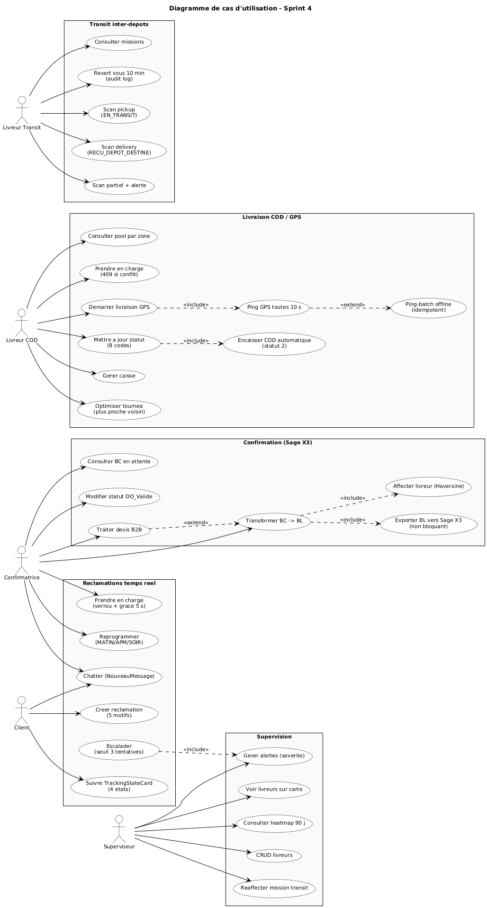

<a id="architecture"></a>
## Architecture globale

L'architecture applique une séparation entre présentation, services métier, persistance et intégrations. L'API ASP.NET Core joue le rôle de point central : elle authentifie les utilisateurs, applique les règles métier, accède à SQL Server et contrôle les échanges avec les services externes.

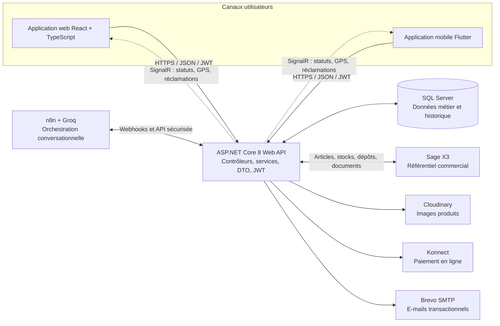

### Principes d'architecture

- **Frontend découplé** : React consomme exclusivement l'API et organise les espaces par rôle.
- **Backend orienté services** : contrôleurs fins, DTO dédiés, services métier et accès EF Core.
- **Persistance centralisée** : SQL Server stocke les utilisateurs, documents, paiements, livraisons, réclamations, transferts, sessions chatbot et insights.
- **ERP maîtrisé** : Sage X3 reste la référence commerciale ; la plateforme expose des interfaces plus adaptées au web et au terrain.
- **Temps réel** : SignalR diffuse les changements de statut, événements de réclamation et positions de livraison.
- **Intégrations isolées** : les clients n'accèdent jamais directement à Sage X3, Cloudinary, Konnect ou n8n.

<a id="flux"></a>
## Flux métier principaux

### Commande client jusqu'à la livraison

```text
Catalogue -> Panier -> Checkout -> Paiement -> Bon de commande
          -> Confirmation -> Bon de livraison -> Affectation livreur
          -> Suivi terrain -> Livraison finale -> Encaissement COD
```

Le client peut commander avec un compte ou via un parcours invité. Le confirmateur vérifie les données et prépare la phase logistique. Le livreur met ensuite à jour la mission depuis l'application mobile ; la plateforme conserve la traçabilité des statuts et des encaissements.

### Gestion des réclamations

Le client crée une réclamation liée à une commande ou une livraison. Le confirmateur consulte le dossier, échange avec le client, met à jour le statut et conserve l'historique du traitement. SignalR permet de notifier les interfaces concernées sans rechargement manuel.

### Transit inter-dépôts

Le transfert interne est distingué de la livraison finale. Une mission de transit relie un dépôt source à un dépôt de destination. Le double scan de code-barres permet de confirmer la sortie puis la réception des colis.

### Parcours B2B

Le client professionnel dispose d'un parcours adapté aux demandes de devis et aux remises personnalisées. Le vendeur peut préparer une commande au nom d'un client et publier le document commercial lorsque les données sont validées.

<a id="fonctionnalites"></a>
## Fonctionnalités par module

### Application web React

- catalogue, recherche, filtres, détail produit et images Cloudinary ;
- panier, favoris, adresses, checkout et suivi des commandes ;
- authentification locale, Google/Facebook OAuth et gestion de profil ;
- espaces client B2C, B2B, vendeur, confirmateur, superviseur et administrateur ;
- gestion des bons de commande, bons de livraison, devis et remises ;
- gestion des réclamations et de leur historique ;
- dashboards ventes, commandes, produits, stocks, logistique et qualité ;
- exports Excel et PDF ;
- centre chatbot : aperçu, sandbox, conversations et insights ;
- personnalisation de la page d'accueil avec brouillon, prévisualisation et publication.

### Web API ASP.NET Core

- API REST structurée par domaines métier ;
- ASP.NET Core Identity, JWT et contrôles d'accès par rôle ;
- Entity Framework Core et migrations SQL Server ;
- services de synchronisation Sage X3 ;
- génération Excel avec ClosedXML et PDF avec QuestPDF ;
- paiements Konnect réels ou simulés selon la configuration ;
- stockage et transformation d'images via Cloudinary ;
- e-mails transactionnels via Brevo SMTP ;
- hubs SignalR pour les événements temps réel ;
- tâches d'arrière-plan Hangfire ;
- analyses, prédictions ML.NET et orchestrateur conversationnel.

### Application mobile Flutter

- authentification et navigation adaptée au rôle ;
- liste et détail des livraisons ;
- prise en charge d'une mission et mise à jour des statuts ;
- géolocalisation, cartes et optimisation d'itinéraire ;
- scan de codes-barres pour les opérations de transit ;
- réclamations et historique des actions ;
- vues administrateur et superviseur ;
- fonctionnement hors ligne partiel avec file de synchronisation ;
- chatbot administrateur avec saisie vocale et synthèse vocale.

<a id="n8n"></a>
## Orchestration n8n et chatbot administrateur

Le chatbot constitue la couche d'aide à la décision du Sprint 5. Il permet à l'administrateur de poser une question métier en langage naturel puis d'obtenir une réponse structurée, des lignes de données, un graphique ou un insight.

### Etat d'intégration

> L'application actuelle appelle principalement `POST /api/admin/chat/ask`. L'orchestration est alors exécutée directement dans `AdminChatOrchestratorService`. Les workflows n8n restent disponibles comme orchestration visuelle alternative, démonstrateur pédagogique et point d'extension pour un déploiement externe.

Cette double approche permet de comparer deux implémentations du même pattern :

- **orchestration C# intégrée** : moins de dépendances pour exécuter l'application localement ;
- **orchestration n8n** : pipeline visible, modifiable et démontrable nœud par nœud.

### Architecture du workflow n8n

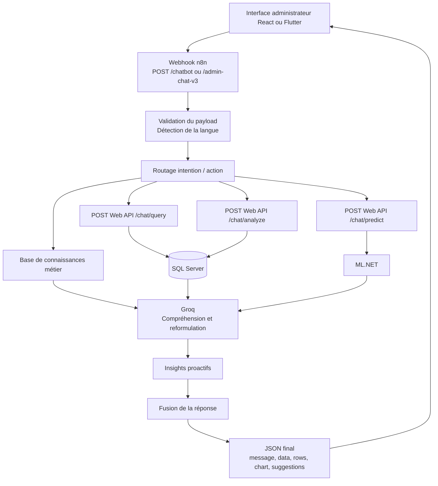

### Responsabilité de chaque composant

| Composant | Rôle |
|---|---|
| Interface admin | Envoie la question et affiche texte, tableaux, graphiques et suggestions |
| Webhook n8n | Point d'entrée du workflow et gestion de la réponse HTTP |
| Nœud de validation | Vérifie la présence de la question et normalise le payload |
| Routeur | Classe la demande en `query`, `analyze`, `predict`, `kb`, `action` ou `chitchat` |
| Web API | Exécute les requêtes métier avec EF Core et applique les règles de sécurité |
| SQL Server | Reste la source des données métier réelles |
| ML.NET | Calcule risques et prévisions pour les tâches prises en charge |
| Groq | Interprète la question et reformule les données structurées en réponse naturelle |
| Insights | Ajoute les tendances ou alertes utiles à l'administrateur |
| Respond to Webhook | Retourne un JSON stable à React ou Flutter |

### Workflows fournis

| Fichier | Niveau | Fonctionnement |
|---|---|---|
| [`admin-chatbot-workflow.json`](automation-n8n/admin-chatbot-workflow.json) | V1 | Détection d'intention puis routage vers des endpoints ciblés |
| [`admin-chatbot-workflow-v2.json`](automation-n8n/admin-chatbot-workflow-v2.json) | V2 | Routage générique vers `query`, `analyze`, `predict`, KB ou conversation |
| [`admin-chatbot-workflow-v3.json`](automation-n8n/admin-chatbot-workflow-v3.json) | V3 | Langue, actions, appel `/chat/ask`, insights proactifs et fusion de réponse |
| [`admin-chatbot-workflow-cloud.json`](automation-n8n/admin-chatbot-workflow-cloud.json) | Démo cloud | Variante à reconfigurer avec une URL backend publique contrôlée |

### Capacités du chatbot

- compter ou lister les commandes et réclamations selon des filtres ;
- afficher le détail d'une commande ;
- identifier les produits les plus demandés ;
- comparer les performances par gouvernorat ou période ;
- analyser tendances, comparaisons, anomalies, corrélations et distributions ;
- prédire le risque de retour et la réussite au premier passage ;
- prévoir les volumes, le chiffre d'affaires et les réclamations ;
- conserver les sessions et les six derniers messages de contexte ;
- détecter le français, l'arabe et le tunisien ;
- retourner des suggestions de questions suivantes ;
- afficher progressivement la réponse via SSE ;
- enregistrer les feedbacks et les insights proactifs ;
- rafraîchir la base de connaissances.

Les prédictions ML.NET utilisent les données réelles lorsqu'elles sont suffisantes. Pour la démonstration académique, un jeu synthétique peut être utilisé en repli lorsqu'il n'existe pas assez d'observations ; le résultat expose cette provenance dans ses métadonnées.

### Sécurité du flux n8n

- les endpoints dédiés à n8n exigent le header `X-Chat-Api-Key` ;
- les endpoints directs `/ask`, `/ask-stream`, sessions et insights exigent un JWT avec rôle administrateur ;
- les clés Groq sont stockées dans les credentials n8n ou la configuration locale, jamais dans le workflow public ;
- le modèle de langage n'accède pas directement à SQL Server ;
- les requêtes métier restent exécutées par les services C# contrôlés ;
- le webhook de démonstration doit être protégé par authentification et reverse proxy en production.

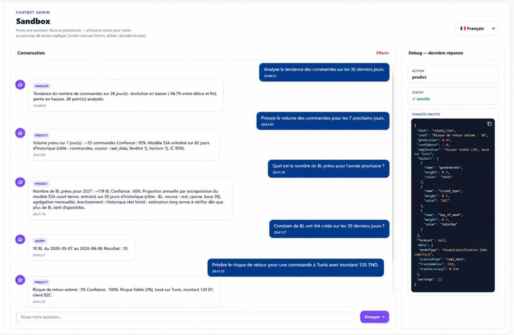

Le guide complet est disponible dans [`automation-n8n/SETUP.md`](automation-n8n/SETUP.md).

<a id="sage-x3"></a>
## Synchronisation Sage X3

Sage X3 joue le rôle de référentiel commercial. La plateforme met en œuvre deux familles de flux :

### Flux descendant : Sage X3 vers la plateforme

- articles et références produit ;
- catalogues ;
- dépôts ;
- niveaux de stock par dépôt ;
- informations utiles aux commandes et dashboards.

L'administrateur peut déclencher une synchronisation par entité ou une synchronisation globale. La Web API interroge le wrapper Sage X3, transforme les données et réalise les insertions ou mises à jour dans SQL Server.

### Flux ascendant : plateforme vers Sage X3

- publication de documents commerciaux validés ;
- transmission des bons de livraison selon la configuration disponible ;
- mapping des champs locaux vers le format attendu par Sage X3 ;
- journalisation des erreurs et contrôle de l'état des échanges.

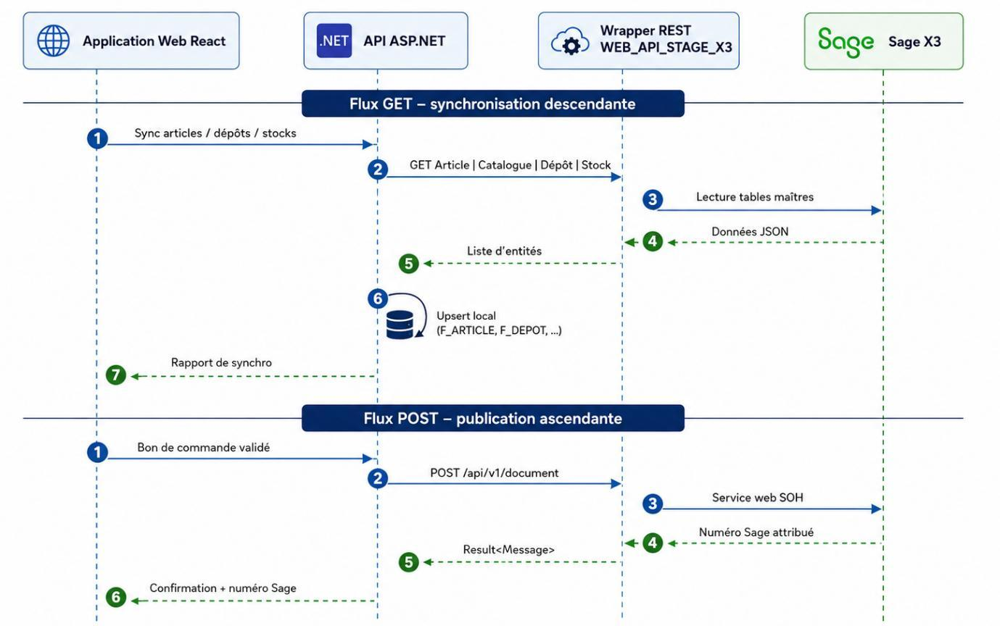

Le dashboard de synchronisation permet de contrôler les compteurs d'articles, dépôts et stocks, ainsi que les alertes d'intégrité ou les dernières opérations.

<a id="sprints"></a>
## Organisation Scrum en cinq sprints

Le développement a suivi Scrum avec collecte des besoins, backlog produit, backlog de sprint, réalisation sur des cycles de deux à quatre semaines et validation progressive.

| Sprint | Périmètre principal | Livrables représentatifs |
|---|---|---|
| Sprint 1 | Socle technique et sécurité | Architecture, comptes, authentification, rôles et autorisations |
| Sprint 2 | Parcours client | Catalogue, panier, favoris, checkout, paiement, commandes B2C/B2B et devis |
| Sprint 3 | Gestion commerciale et Sage X3 | Back-office, vendeur, stocks, documents, Cloudinary et synchronisation ERP |
| Sprint 4 | Logistique terrain | Confirmation, BC vers BL, livraison COD, GPS, SignalR, réclamations et transit |
| Sprint 5 | Pilotage et aide à la décision | Dashboards, exports Excel/PDF, insights, ML.NET et chatbot n8n |

Le Sprint 5 a ajouté une dimension décisionnelle aux modules opérationnels développés auparavant. Les indicateurs couvrent notamment ventes, commandes, stocks, livraisons, livreurs, clients, réclamations et qualité de synchronisation.

<a id="uml"></a>
## Conception UML et modèle de données

La conception UML a servi à formaliser les responsabilités des acteurs, les interactions et les principales entités avant l'implémentation.

### Entités principales

- utilisateurs Identity et profils applicatifs ;
- articles, catalogues, stocks et dépôts ;
- en-têtes et lignes de documents commerciaux ;
- paiements et encaissements COD ;
- livraisons, historiques et positions ;
- réclamations, messages et décisions ;
- transferts inter-dépôts ;
- sessions, messages, actions et insights chatbot.

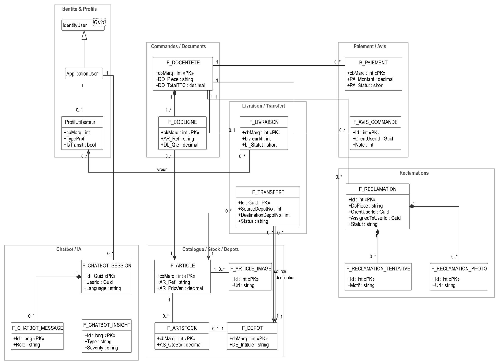

### Exemple de séquence : transformation BC vers BL

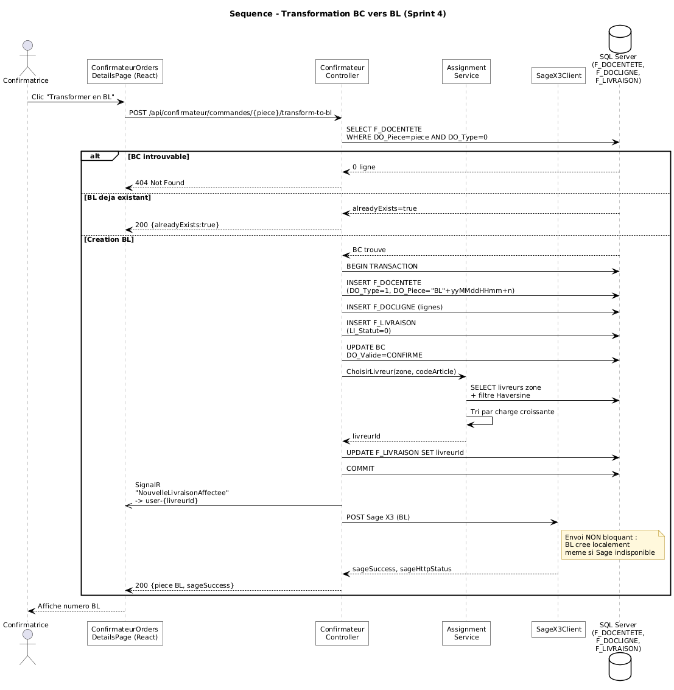

<a id="captures"></a>
## Captures de réalisation

### Parcours client web

| Détail produit | Favoris client |
|---|---|
| 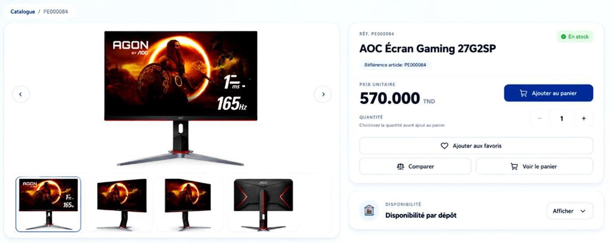 | 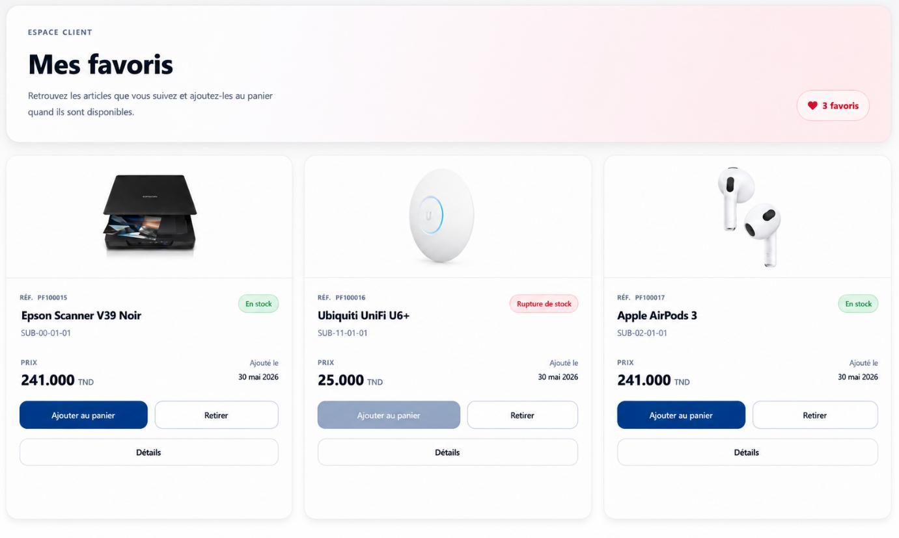 |

### Administration et pilotage

| Dashboard global | Centre de contrôle |
|---|---|
| 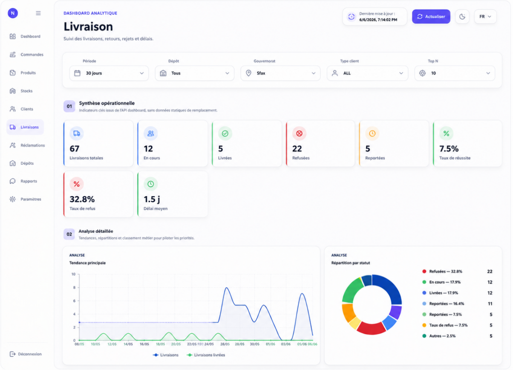 | 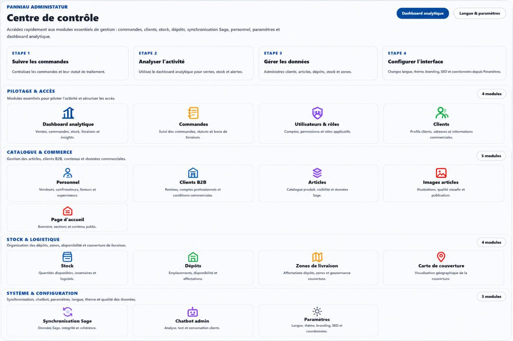 |

| Gestion des commandes | Qualité de synchronisation |
|---|---|
| 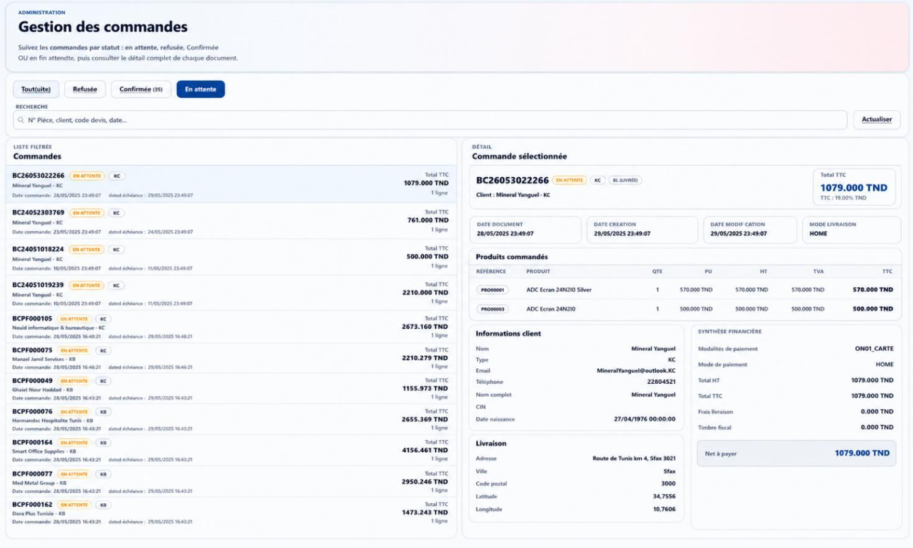 | 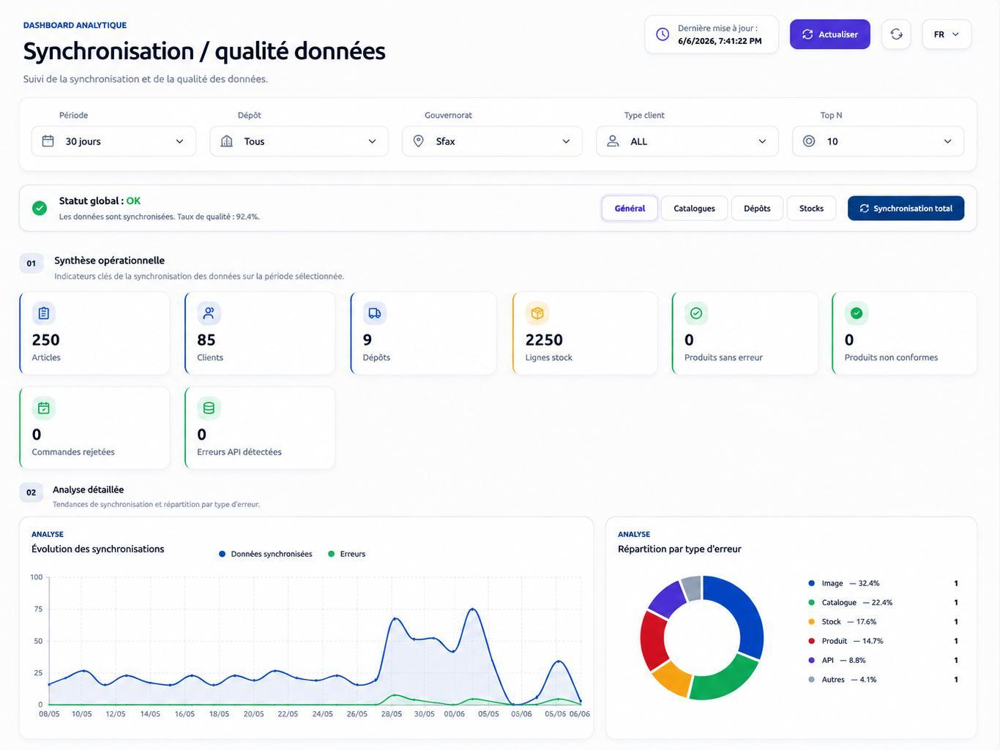 |

| Gestion des stocks | Exports Excel et PDF |
|---|---|
| 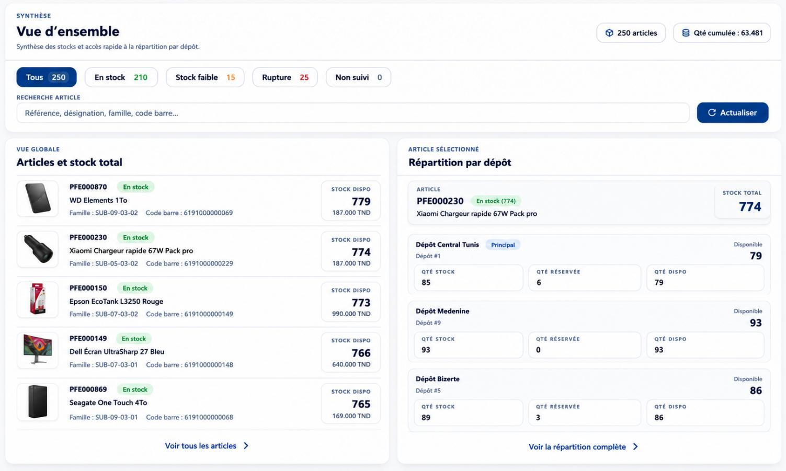 | 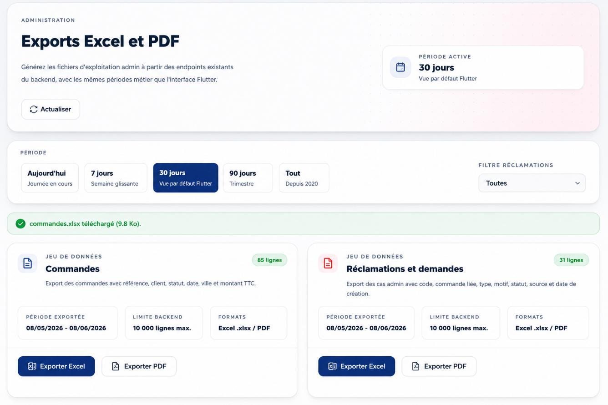 |

### Application mobile et terrain

| Missions de livraison | Scan code-barres | Vue superviseur |
|---|---|---|
| 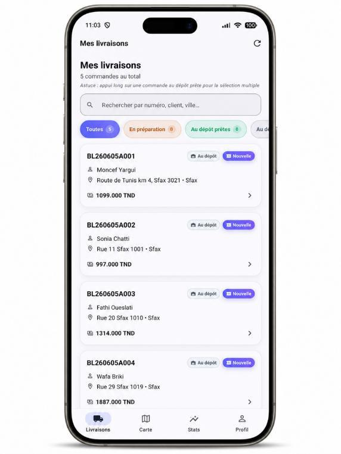 | 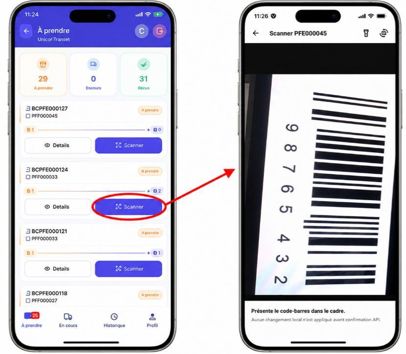 | 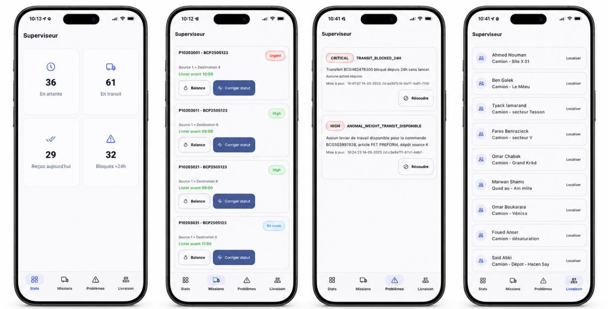 |

### Chatbot et automatisation

| Interface chatbot | Séquence d'orchestration |
|---|---|
|  | 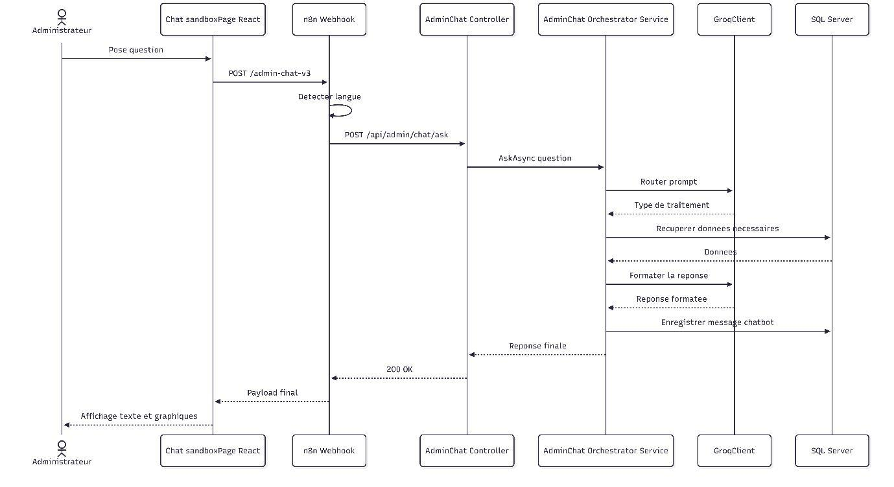 |

<a id="stack-technique"></a>
## Stack technique

| Couche | Technologies et bibliothèques |
|---|---|
| Frontend web | React 19, TypeScript 5, Vite 7, Tailwind CSS 4, React Router, React Query, Zustand, Axios, Recharts, Leaflet, i18next |
| Backend | ASP.NET Core 8, C#, Entity Framework Core 8, Identity, JWT, Swagger, SignalR, Hangfire |
| Données | SQL Server, migrations EF Core, NetTopologySuite |
| Mobile | Flutter, Dart, Provider, Google Maps, Geolocator, SignalR, Hive, Mobile Scanner, Speech-to-Text, TTS |
| Documents | ClosedXML pour Excel, QuestPDF pour PDF, ZXing pour les codes-barres |
| IA et analyse | Groq, ML.NET, analyse statistique, prévisions et insights |
| Automatisation | n8n, webhooks, nœuds HTTP, routage et fusion de réponses |
| Intégrations | Sage X3, Cloudinary, Konnect, Brevo SMTP, Google OAuth et Facebook OAuth |
| Tests | xUnit, EF Core InMemory, Vitest, Testing Library et Flutter Test |

<a id="structure"></a>
## Structure du dépôt

```text
pfe-ecommerce-logistique-transit/
|-- backend-aspnet-api/
|   |-- Web-Api/                 # API, services, modèles, migrations et intégrations
|   `-- Web-Api.Tests/           # Tests xUnit ciblés
|-- frontend-react/
|   `-- src/                     # Application web et back-office par fonctionnalités
|-- mobile-flutter/
|   |-- lib/                     # Application mobile, services, providers et écrans
|   `-- test/                    # Tests Flutter
|-- automation-n8n/              # Workflows V1, V2, V3, setup et base de connaissances
|-- docs/
|   `-- assets/                  # Architectures, UML et captures extraites du PFE
|-- README.md
`-- .gitignore
```

<a id="installation"></a>
## Installation locale

### Prérequis

- Git ;
- .NET SDK 8 ou version compatible avec `net8.0` ;
- SQL Server ;
- Node.js LTS et npm ;
- Flutter 3.x et Dart ;
- n8n 1.50+ uniquement pour exécuter les workflows visuels ;
- accès aux services externes uniquement pour tester leurs intégrations réelles.

### 1. Cloner le dépôt

```bash
git clone https://github.com/Melek-Lahmar/pfe-ecommerce-logistique-transit.git
cd pfe-ecommerce-logistique-transit
```

### 2. Démarrer le backend

```bash
cd backend-aspnet-api
dotnet restore
dotnet build
dotnet run --project Web-Api/Web-Api.csproj
```

Avant le premier démarrage, copier `Web-Api/appsettings.example.json` vers un fichier de configuration local et renseigner SQL Server, JWT et les intégrations nécessaires.

Pour appliquer les migrations :

```bash
dotnet ef database update --project Web-Api/Web-Api.csproj
```

### 3. Démarrer le frontend React

```bash
cd frontend-react
npm install
npm run dev
```

Le frontend Vite est généralement disponible sur `http://localhost:5173`.

### 4. Démarrer l'application Flutter

```bash
cd mobile-flutter
flutter pub get
flutter run
```

L'URL backend peut être fournie avec `--dart-define` selon la cible :

```bash
flutter run --dart-define=API_BASE_URL=https://localhost:7178
```

### 5. Lancer n8n

```bash
npx n8n
```

Puis importer le workflow choisi depuis `automation-n8n/`, configurer `WEBAPI_BASE_URL`, `CHATBOT_API_KEY` et le credential Groq, puis activer le webhook. Voir le [guide n8n](automation-n8n/SETUP.md).

<a id="configuration"></a>
## Configuration

### Backend

| Section | Utilité |
|---|---|
| `ConnectionStrings:DefaultConnection` | Base SQL Server de la plateforme |
| `ConnectionStrings:SageX3Connection` | Connexion aux données Sage X3 lorsque requise |
| `Jwt` | Emetteur, audience, clé de signature et expiration |
| `Sage` / `SageX3` | URL du wrapper, client et dépôt par défaut |
| `Chatbot:ApiKey` | Clé partagée entre n8n et les endpoints chatbot |
| `Groq` | URL, modèle et clé de l'orchestrateur conversationnel |
| `ExternalAuth` | Google et Facebook OAuth |
| `Cloudinary` | Compte, dossiers et limites des images |
| `Konnect` | Mode mock/sandbox/production et paramètres de paiement |

Le modèle complet est disponible dans [`appsettings.example.json`](backend-aspnet-api/Web-Api/appsettings.example.json).

### Frontend

Créer `frontend-react/.env.local` :

```env
VITE_API_BASE_URL=https://localhost:7178
VITE_MAPBOX_TOKEN=YOUR_MAPBOX_PUBLIC_TOKEN
```

### n8n

```env
WEBAPI_BASE_URL=https://localhost:7178
CHATBOT_API_KEY=YOUR_CHATBOT_API_KEY
```

La clé Groq doit être enregistrée dans les credentials n8n, pas dans le JSON du workflow.

<a id="qualite"></a>
## Sécurité, qualité et validation

### Mesures de sécurité

- mots de passe gérés par ASP.NET Core Identity ;
- JWT signé et contrôle des rôles sur les endpoints sensibles ;
- clé API dédiée aux échanges n8n vers le backend ;
- secrets exclus du dépôt et remplacés par des placeholders ;
- validation des fichiers et des types MIME pour les médias ;
- accès SQL encapsulé dans EF Core et les services métier ;
- séparation entre endpoints administrateur, client, vendeur, confirmateur et livreur ;
- modes mock/sandbox prévus pour éviter les paiements réels pendant la démonstration.

### Validation réalisée lors de la préparation du dépôt

| Composant | Commande | Résultat |
|---|---|---|
| Backend | `dotnet restore` | Restauration réussie avec avertissement de résolution ZXing |
| Backend | `dotnet build` | Compilation réussie, 0 erreur ; avertissements de nullabilité et migrations existantes |
| Frontend | `npm run build` | TypeScript et build Vite réussis ; avertissement sur la taille de certains chunks |
| Mobile | `flutter analyze` | Aucun diagnostic bloquant ; informations de dépréciation à traiter |
| Documentation | Vérification des liens et assets | Captures et diagrammes présents dans `docs/assets` |

Le dépôt contient également des tests xUnit ciblant notamment les utilisateurs administrateur, remises B2B, favoris, géolocalisation, frais de livraison et paiement virtuel.

<a id="perspectives"></a>
## Limites et perspectives

Cette version constitue une base fonctionnelle de PFE, pas un déploiement de production clé en main. Les principales évolutions identifiées sont :

- renforcer la couverture de tests automatisés et les scénarios end-to-end ;
- optimiser les performances avec des volumes de données plus importants ;
- consolider la connexion Sage X3 dans une infrastructure de production réelle ;
- industrialiser n8n derrière un reverse proxy authentifié ;
- supprimer progressivement les replis synthétiques des modèles ML.NET au profit de données historiques suffisantes ;
- améliorer l'observabilité, les métriques, les logs et les alertes ;
- renforcer la résilience hors ligne de l'application mobile ;
- enrichir les dashboards, insights et capacités conversationnelles ;
- mettre en place une chaîne CI/CD et une stratégie de déploiement reproductible.

<a id="auteurs"></a>
## Auteurs et encadrement

### Réalisation

- **Melek Lahmar**
- **Tawfik Siala**

### Encadrement

- **M. Yousri Fakhfakh**, encadrant académique ;
- **M. Majdi Radadi**, encadrant industriel ;
- **M. Mohamed Dhieb**, encadrant industriel.

### Etablissement et entreprise d'accueil

- Institut Supérieur des Etudes Technologiques de Sfax ;
- Département Technologies de l'Information ;
- InfoSoft.

## Licence et usage

Projet académique publié à des fins de démonstration technique, de soutenance et de portfolio. Toute réutilisation du code, des visuels ou de la documentation nécessite l'accord préalable des auteurs.

---

<div align="center">
  <strong>React + ASP.NET Core + SQL Server + Flutter + Sage X3 + n8n</strong>
</div>
